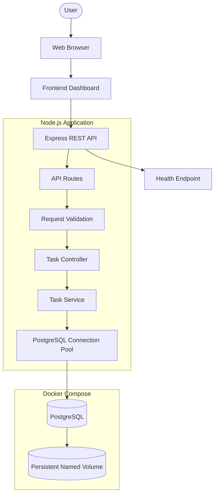
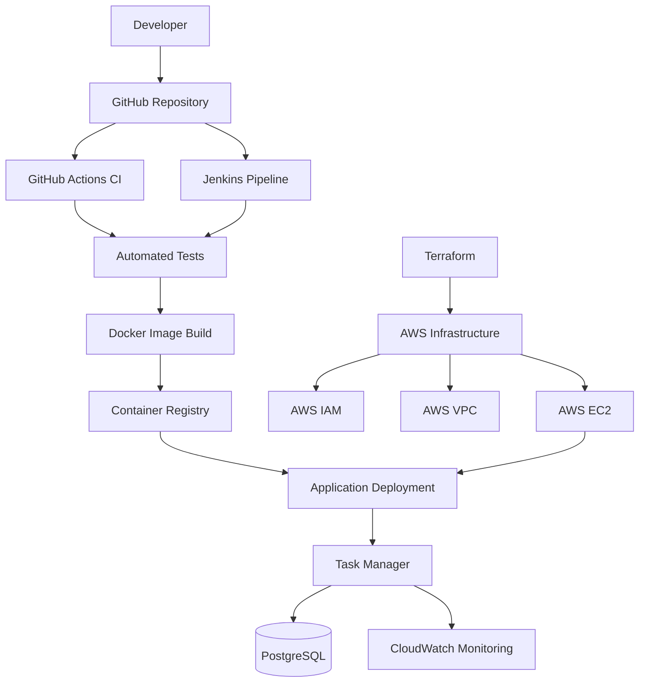

# Cloud-Native Task Manager

A modern task management application built with **Node.js, Express.js, PostgreSQL, and Docker**. This project combines full-stack development with a planned DevOps workflow covering CI/CD, AWS cloud deployment, Terraform, Jenkins, and Kubernetes.

## Overview

Task Manager provides a responsive dashboard for organizing tasks and tracking their progress. The Express REST API handles task operations, while PostgreSQL stores application data. Docker Compose runs the application and database in isolated containers with persistent database storage.

The project is being developed as an end-to-end cloud-native and DevOps portfolio project.

## Features

- **Task Management:** Create, view, update, and delete tasks.
- **Task Status:** Track pending, in-progress, and completed work.
- **Search and Filtering:** Search tasks, filter by status, sort, and paginate results.
- **Dashboard Metrics:** View task totals and status statistics.
- **Responsive UI:** Clean dashboard with light and dark themes.
- **REST API:** Versioned endpoints, request validation, and consistent error handling.
- **Database Integration:** PostgreSQL with parameterized SQL queries.
- **Containerization:** Docker images and Docker Compose services.
- **Persistent Storage:** Named Docker volume for PostgreSQL data.
- **Automated Testing:** Integration tests for API and database behavior.
- **Health Checks:** Monitor application and database readiness.

## Technology Stack

| Category | Technologies |
|---|---|
| Frontend | HTML5, CSS3, JavaScript |
| Backend | Node.js, Express.js |
| Database | PostgreSQL |
| Database Driver | `pg` |
| Validation | Express Validator |
| Containerization | Docker, Docker Compose |
| Testing | Node.js Test Runner |
| Version Control | Git, GitHub |
| CI/CD — Planned | GitHub Actions, Jenkins |
| Cloud — Planned | AWS EC2, IAM, VPC, CloudWatch |
| Infrastructure as Code — Planned | Terraform |
| Orchestration — Planned | Kubernetes |

## Architecture

The current application follows a layered architecture. The browser communicates with the Express API, which validates incoming requests and delegates database operations to the service layer.

### Application Architecture



### Planned DevOps and Cloud Architecture

The following diagram represents the target workflow, not a claim that every component has already been deployed.



## Project Structure

```text
cloud-native-task-manager/
├── database/
│   └── schema.sql
├── public/
│   ├── index.html
│   ├── styles.css
│   └── app.js
├── src/
│   ├── config/
│   ├── controllers/
│   ├── middleware/
│   ├── routes/
│   ├── services/
│   ├── validators/
│   ├── app.js
│   └── server.js
├── tests/
├── .dockerignore
├── .env.example
├── .env.docker.example
├── .gitignore
├── Dockerfile
├── compose.yaml
├── package.json
├── package-lock.json
└── README.md
```

## Getting Started

### Prerequisites

- Node.js 22 or a compatible version.
- PostgreSQL for local development.
- Docker Desktop and Docker Compose for containerized execution.
- Git for version control.

### Option 1: Run Locally

**1. Install dependencies**

```powershell
npm install
```

**2. Configure environment variables**

```powershell
Copy-Item .env.example .env
```

Update `.env` with your local PostgreSQL host, port, database name, username, and password.

**3. Start the application**

```powershell
npm run dev
```

**4. Open the application**

- Dashboard: `http://localhost:5000`
- Health endpoint: `http://localhost:5000/health`

Make sure your local PostgreSQL server is running and the configured database has the required schema.

### Option 2: Run with Docker

Docker Compose starts the application and PostgreSQL as separate services.

**1. Configure Docker environment variables**

```powershell
Copy-Item .env.docker.example .env.docker
```

Set a strong, unique database password in `.env.docker`. Keep this file private.

**2. Build and start the containers**

```powershell
docker compose --env-file .env.docker up --build -d
```

**3. Verify container health**

```powershell
docker compose --env-file .env.docker ps
```

**4. Open the dashboard**

With `HOST_PORT=5001` configured, visit:

`http://localhost:5001`

**5. View container logs**

```powershell
docker compose --env-file .env.docker logs --tail 100 app db
```

**6. Stop the services**

```powershell
docker compose --env-file .env.docker down
```

The named PostgreSQL volume preserves container database data when the services are stopped. Avoid `docker compose down -v` unless you intentionally want to remove that volume and its data.

The Docker database is separate from the local Windows PostgreSQL instance.

## REST API

Base URL: `http://localhost:5000`

| Method | Endpoint | Description |
|---|---|---|
| GET | `/health` | Check application and database health |
| GET | `/api/v1/tasks` | List tasks and metrics |
| GET | `/api/v1/tasks/:id` | Retrieve a task |
| POST | `/api/v1/tasks` | Create a task |
| PUT | `/api/v1/tasks/:id` | Update a task |
| DELETE | `/api/v1/tasks/:id` | Delete a task |

### Supported Task Statuses

- `pending`
- `in_progress`
- `completed`

The list endpoint supports searching, filtering, sorting, and pagination.
